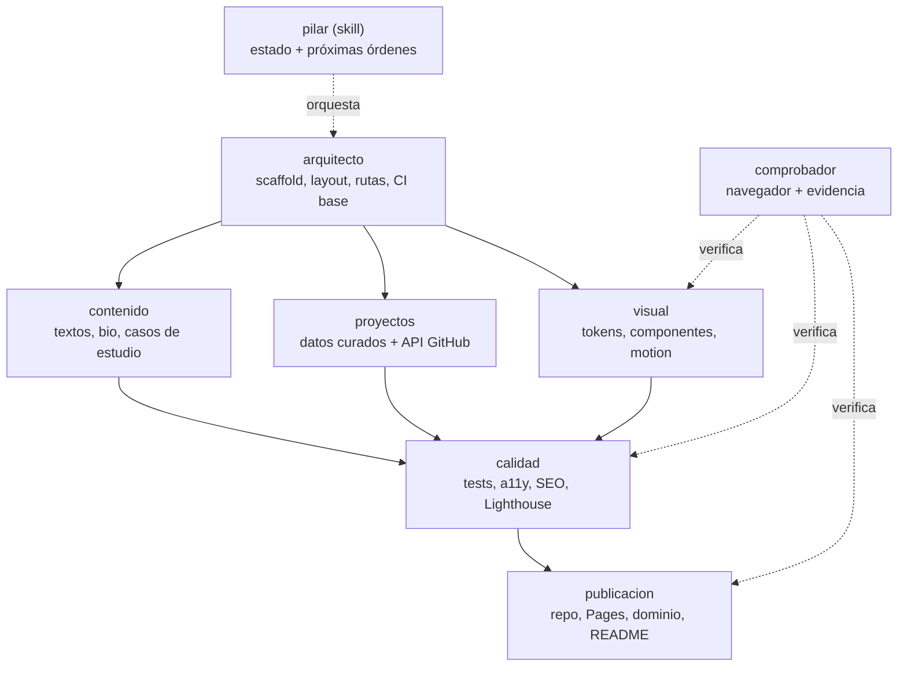

# Mapa de trabajo — Portfolio web

## Cómo se usa esto

- Antes de escribir código, cualquier sesión lee `docs/plan/CONCEPTO.md` (qué construimos) y este archivo (cómo lo repartimos).
- El trabajo se divide en 6 bloques. Cada uno tiene un rol en `.claude/agents/<rol>.md` y una checklist en `docs/plan/todo/<rol>.md`.
- Para saber por dónde seguir: invoca `/pilar` en cualquier sesión de este repo. Lee el estado real del código y los TODO y genera las órdenes para lanzar lo siguiente.
- Regla de oro: **cada bloque toca solo sus archivos** (ver «Alcance de archivos»). Si una sesión necesita salir de ahí, para y lo dice.

## Stack decidido (por defecto, revocable — ver «Decisiones abiertas»)

| Pieza | Elección | Por qué |
|---|---|---|
| Framework | **Astro** (estático) + TypeScript estricto | HTML casi sin JS, ideal para GitHub Pages y Lighthouse |
| Estilos | CSS propio con tokens (custom properties), sin librería de UI | Control total, peso mínimo |
| Contenido | Content Collections de Astro (`src/content/`) + `src/data/projects.ts` | Añadir un proyecto = una entrada |
| Datos GitHub | API REST de GitHub **en build** (`GITHUB_TOKEN` del Action) con caché y fallback | Sin llamadas del navegador, sin rate limit para el visitante |
| Hosting | GitHub Pages desde GitHub Actions | Gratis, mismo sitio que el código |
| Calidad | ESLint + `astro check` + Vitest + Playwright + axe + Lighthouse CI | Cubre tipos, lógica, a11y y rendimiento |

## Skills obligatorias por bloque

Regla: **si la tarea coincide con la capacidad de una de estas skills, se usa** (invocarla con la herramienta Skill antes de escribir o auditar). Las skills `impeccable`, `design-taste-frontend`, `animate`, `emil-design-eng` y `apple-design` siguen disponibles como apoyo del bloque `visual`, pero las de esta tabla van primero.

| Skill | Para qué | Bloque / momento |
|---|---|---|
| `astro` | Componentes `.astro`, rutas, content collections, despliegue estático | `arquitecto`, `proyectos`, `publicacion` |
| `ui-taste` | Anti «UI slop»: hero, tarjetas, tipografía, revisión visual final | `visual` (hero, tarjetas de proyecto, tipografía) y cierre |
| `web-design-guidelines` | Auditar UI contra las Web Interface Guidelines de Vercel | Al terminar **cada sección** o carpeta de componentes (`visual`, `proyectos`) |
| `accessibility` | Auditoría WCAG 2.2: teclado, lector de pantalla, contraste, foco | `calidad`, al cerrar su parte de a11y; también `comprobador` |
| `seo-audit` | Metadatos, Open Graph, sitemap, Core Web Vitals | `calidad` y `publicacion`, antes de publicar |
| `motion-doctrine` | Principios de movimiento (continuidad, dirección, sin idle wobble) | `visual`, al definir el motion. Ojo: está escrita para vídeos HyperFrames; se aplican sus principios, no sus herramientas |
| `ios-design` | Guías de iPhone | **No aplica** (web); no se usa. Puede borrarse |

Cada tarea que use una skill lo anota en su casilla de `todo/<bloque>.md` («auditado con `accessibility`: N hallazgos»). `/pilar` avisa si se cierra un bloque sin pasar por las skills que le tocan.

## Trabajar con varias herramientas (Claude Code + Codex)

`CONCEPTO.md`, este archivo, `TODO.md` y `todo/*.md` son markdown normal: los lee cualquier agente. Lo exclusivo de Claude Code son `.claude/agents/*.md` y `.claude/skills/pilar/`.

### Criterio de reparto

Se reparte por diferencia de herramienta, no por «quién programa mejor»:

- **Claude Code**: subagentes con rol fijo y `/pilar`. Encaja con tareas que cruzan bloques, decisiones de diseño/contenido con criterio subjetivo y todo lo que exige leer el plan entero.
- **Codex**: sesión plana sin subagentes. Encaja con tareas totalmente acotadas: alcance de archivos cerrado y «terminado» objetivo (tests verdes, un archivo creado, un cliente contra una interfaz congelada).

Etiquetas en las casillas abiertas de `todo/<bloque>.md`:

- **`[Codex]`** — acotada a un archivo/carpeta, criterio objetivo.
- **`[Claude]`** — cruza bloques, o decisión subjetiva, o necesita el roadmap.
- **`[comprobador]`** — comprobar en navegador (la lanza Claude Code con el agente `comprobador`).
- **Sin etiqueta** — bloqueada (falta una decisión o dato del usuario) o sin decidir.

### Reglas de siempre

1. Mismos bloques, mismo «Alcance de archivos» — es lo que evita pisarse.
2. A Codex se le da la instrucción **completa y autocontenida**; nunca «actúa como el agente X».
3. Si corren las dos herramientas a la vez: un `git worktree` cada una (`git worktree add ../portofolio-codex-<tarea> -b codex/<tarea>`). Una detrás de otra: basta cambiar de rama.
4. `TODO.md` y `todo/*.md` son el tablero compartido: quien complete algo lo marca y **quita la etiqueta** de herramienta.
5. Al terminar, borra worktree y rama. En Windows, si `git worktree remove` falla por `Filename too long` (por `node_modules`), borra el directorio con prefijo `\\?\` y luego `git worktree prune`.

### Regla fija de revisión

Todo agente que escriba código (`arquitecto`, `contenido`, `proyectos`, `visual`, `calidad`, `publicacion` o un `[Claude]` suelto) pasa por `codex review` sobre su diff **antes de fusionar o commitear en `main`**. Excepción: `comprobador` (no escribe código de producto). La lanza la sesión que orquesta (los subagentes no tienen el plugin de Codex), en modo `-s read-only`. Los hallazgos se corrigen o se anotan en el `todo/<bloque>.md` antes de cerrar la casilla. Si el autor era Codex, revisa Claude.

## Mapa mental

## Dependencias

- `arquitecto` bloquea al resto (da scaffold, layout y contratos de datos).
- Tras `arquitecto`, `contenido`, `proyectos` y `visual` van **en paralelo** (no comparten archivos).
- `calidad` es incremental: arranca con el scaffold (lint, tipos, CI) y se completa cuando los otros entregan.
- `publicacion` es lo último y tiene acciones hacia fuera: **cada una requiere confirmación del usuario**.
- `comprobador` puede correr a la vez que cualquier bloque (no escribe código); indica siempre el commit y si es build local o la URL de Pages.

## Bloques y alcance de archivos

### 1. `arquitecto` — base
Scaffold Astro + TS estricto, `astro.config.mjs` (`site`, `base`), layout base (`<head>`, header, footer, skip-link), rutas vacías (`/`, `/proyectos/[slug]`, `/sobre-mi`, `/contacto`, `/404`), contrato de tipos `Project` y `SiteConfig`, scripts npm.
**Archivos**: `package.json`, `astro.config.mjs`, `tsconfig.json`, `src/layouts/`, `src/pages/` (solo shells), `src/types/`, `.gitignore`, `.editorconfig`.
**Congela**: tipo `Project` (`src/types/project.ts`) y `src/config/site.ts`.

### 2. `contenido` — textos
Hero, bio, «Sobre mí», contacto, y un caso de estudio corto por proyecto destacado (problema → decisión → resultado → stack → enlaces). Tono directo, sin adjetivos huecos.
**Archivos**: `src/content/**`, `src/config/site.ts` (solo campos de texto, ya congelados por arquitecto).
**Depende de**: decisiones abiertas D3, D4, D5.

### 3. `proyectos` — datos
Capa curada `src/data/projects.ts` (qué se destaca, orden, slug, demo, visibilidad) + cliente de la API de GitHub en build (stars, lenguajes, último push, descripción) con caché en `.cache/` y fallback si falla/limita. Lista de «otros repos» filtrando forks, archivados y privados no marcados.
**Archivos**: `src/data/`, `src/lib/github/`, `src/components/projects/` (lógica y estructura; el estilo lo pone `visual`).
**Nunca**: llamar a la API desde el navegador; incluir un token en el bundle.

### 4. `visual` — diseño
Tokens (color, tipografía, espaciado, radios, sombras) con claro/oscuro, componentes de UI (botón, tarjeta, tag, nav), hero, motion (entrada, hover, transiciones de vista) siempre con `prefers-reduced-motion`. Dirección estética decidida en D2.
**Archivos**: `src/styles/`, `src/components/ui/`, `src/components/sections/`, `public/fonts/`, `public/img/`.
**Usa**: skills `impeccable`, `design-taste-frontend`, `animate`, `apple-design` según la dirección elegida.

### 5. `calidad` — verificación
ESLint + Prettier, `astro check`, Vitest (lib de GitHub, ordenación, filtros), Playwright (rutas, nav por teclado, tema), axe (0 violaciones), Lighthouse CI (≥ 95 en las cuatro), SEO (title/description por página, Open Graph, `sitemap.xml`, `robots.txt`, JSON-LD `Person`), comprobador de enlaces rotos.
**Archivos**: `tests/`, `eslint.config.js`, `.prettierrc`, `vitest.config.ts`, `playwright.config.ts`, `lighthouserc.json`, `.github/workflows/ci.yml`, `src/pages/robots.txt.ts`.

### 6. `publicacion` — salida
Repo `thejowe/thejowe.github.io` (o el nombre decidido en D1), workflow `pages.yml` (build + deploy con `GITHUB_TOKEN`), activar Pages, README del repo, README de perfil (`thejowe/thejowe`) enlazando el portfolio, dominio propio opcional.
**Archivos**: `.github/workflows/pages.yml`, `README.md`, `public/CNAME` (si hay dominio).
**Acciones hacia fuera**: crear repo, push, activar Pages, publicar README de perfil → **siempre pedir confirmación antes**.

## Comprobaciones en navegador: el agente `comprobador`

Toda casilla que diga «comprobar a mano», «ver en móvil» o «medir» la hace el agente `comprobador` (`.claude/agents/comprobador.md`) con Playwright/Chrome DevTools: levanta `npm run preview`, recorre rutas en 3 viewports (375, 768, 1440), en claro y oscuro, con y sin `prefers-reduced-motion`, y deja evidencia (capturas, informe Lighthouse, salida de axe) en `tests/artifacts/local/`.

- **No es un bloque**: sin alcance de producto ni checklist propia. Anota hallazgos en el `todo/<bloque>.md` del responsable («Hallazgos del comprobador») y no marca casillas ajenas.
- **Sigue siendo del usuario**: lo que solo él puede dar — su foto, su CV, credenciales, validar que el tono suena a él, aprobar acciones hacia fuera.

## Decisiones abiertas (con valor por defecto)

| # | Decisión | Por defecto si no se responde | Bloquea |
|---|---|---|---|
| D1 | Nombre del repo / URL | `thejowe/thejowe.github.io` → `https://thejowe.github.io` | `publicacion` |
| D2 | Dirección estética (minimalista editorial, brutalista, oscuro tipo terminal, etc.) | Editorial minimalista, claro/oscuro, una tipografía serif + una mono | `visual` |
| D3 | Nombre a mostrar y posicionamiento (una frase) | Pendiente — el usuario lo da | `contenido` |
| D4 | Qué repos privados se muestran (y con qué nivel de detalle) | Ninguno hasta que lo diga | `proyectos`, `contenido` |
| D5 | Idiomas | Español primero; inglés como Fase 2 | `contenido` |
| D6 | Dominio propio | No, usar `github.io` | `publicacion` |
| D7 | Foto/avatar y CV (PDF) | Avatar de GitHub, sin CV | `contenido`, `visual` |
| D8 | Enlaces de contacto (email, LinkedIn…) | Solo GitHub + email del usuario | `contenido` |

Cuando el usuario responda una decisión, se actualiza esta tabla y se desbloquean las casillas afectadas.
